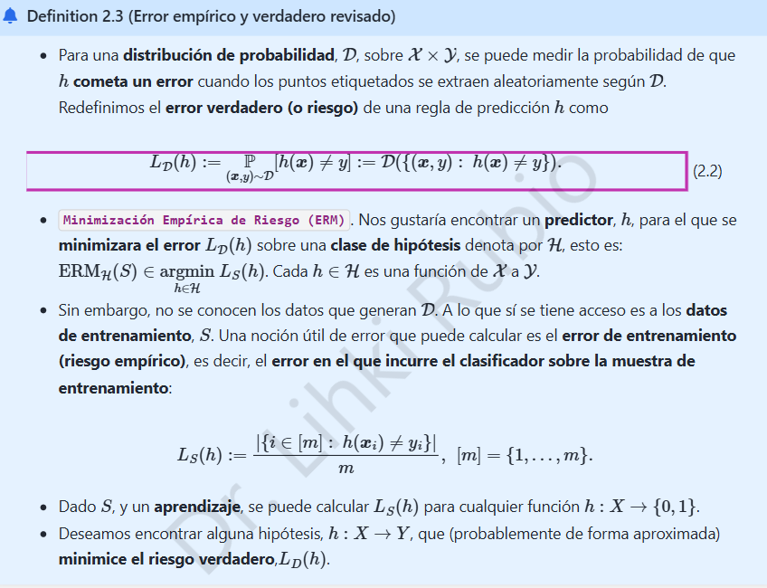

# 1. K-NN · Riesgo verdadero y empírico

## 1.1 ¿Qué se debe justificar?

La **definición 2.3** representa el riesgo verdadero como la probabilidad de una clasificación equivocada y el riesgo empírico como el porcentaje de errores sobre una muestra etiquetada. Demostraremos ambas equivalencias. Añadiremos la propiedad de insesgadez **solo para un clasificador fijo**, una precisión metodológica importante.

Sea $\mathcal D$ una distribución de probabilidad sobre pares $(X,Y)$, con $X\in\mathcal X$ y $Y\in\mathcal Y$. Un clasificador $h:\mathcal X\to\mathcal Y$ predice una etiqueta $h(x)$.

## 1.2 Riesgo verdadero

Definamos el evento de clasificación incorrecta $A_h=\{(x,y):h(x)\ne y\}$ y la **pérdida 0–1**

$$\ell(h;x,y)=\mathbf 1\{h(x)\ne y\}=\begin{cases}1,&h(x)\ne y,\\0,&h(x)=y.\end{cases}$$

La esperanza de una indicadora es la probabilidad del evento que representa. Por ello,

$$\boxed{L_{\mathcal D}(h)=\mathbb E_{(X,Y)\sim\mathcal D}[\ell(h;X,Y)]=\mathbb P_{\mathcal D}(h(X)\ne Y)=\mathcal D(A_h).}$$

Esta expresión no depende del conjunto concreto de entrenamiento: mide el desempeño esperado en la población modelada por $\mathcal D$.

## 1.3 Riesgo empírico

Dada una muestra etiquetada $S=\{(x_i,y_i)\}_{i=1}^m$, el número total de equivocaciones es la suma de indicadores. Por tanto,

$$\boxed{L_S(h)=\frac{1}{m}\sum_{i=1}^m\mathbf 1\{h(x_i)\ne y_i\}=\frac{|\{i:h(x_i)\ne y_i\}|}{m}.}$$

Esta cantidad **sí se puede calcular** con los ejemplos observados, aunque la distribución $\mathcal D$ sea desconocida. Minimización empírica del riesgo significa buscar $\hat h\in\arg\min_{h\in\mathcal H}L_S(h)$ dentro de una clase de hipótesis $\mathcal H$.

## 1.4 Relación entre ambos riesgos y condición importante

Supongamos que $S\sim\mathcal D^m$ consiste en observaciones independientes e idénticamente distribuidas y que **$h$ se fijó sin utilizar $S$**. Entonces, por linealidad de la esperanza,

$$\begin{aligned}\mathbb E_S[L_S(h)]&=\mathbb E_S\left[\frac{1}{m}\sum_{i=1}^m\mathbf 1\{h(x_i)\ne y_i\}\right]\\&=\frac{1}{m}\sum_{i=1}^m\mathbb P_{\mathcal D}(h(X)\ne Y)=L_{\mathcal D}(h).\end{aligned}$$

Así, para $h$ fijo, $L_S(h)$ es un estimador insesgado de $L_{\mathcal D}(h)$, y por independencia su varianza es $L_{\mathcal D}(h)[1-L_{\mathcal D}(h)]/m$.

> **Precisión:** si se escoge $h$ *minimizando errores sobre esa misma muestra*, la igualdad de insesgadez no se deduce automáticamente: la selección produce optimismo del error de entrenamiento. Esta es la razón de reservar datos independientes para evaluar modelos.

## 1.5 Conexión con el clasificador óptimo de Bayes

Si $Y\in\{0,1\}$ y $\eta(x)=\mathbb P(Y=1\mid X=x)$, el riesgo condicionado al punto $x$ es $\eta(x)$ si predecimos 0 y $1-\eta(x)$ si predecimos 1. El mínimo de ambos se logra mediante

$$h^*(x)=\begin{cases}1,&\eta(x)\ge \tfrac12,\\0,&\eta(x)<\tfrac12.\end{cases}$$

Luego,

$$\boxed{L_{\mathcal D}(h^*)=\mathbb E_X[\min\{\eta(X),1-\eta(X)\}]\le L_{\mathcal D}(h)}$$

para cualquier clasificador $h$. Esta identidad es la referencia que utilizaremos en el capítulo siguiente.

**Conclusión:** el riesgo empírico describe los errores observados; el verdadero describe los errores esperados. Ambos se escriben con la pérdida 0–1, pero no deben confundirse.
