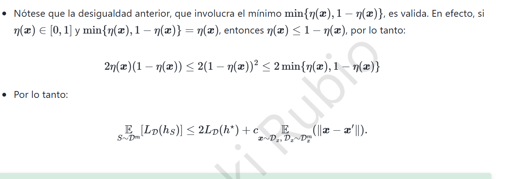

# 2. K-NN · Caso $\min\{\eta,1-\eta\}=1-\eta$

## 2.1 Desigualdad a demostrar

Con $\eta=\eta(x)\in[0,1]$, el resultado requerido es

$$\boxed{2\eta(1-\eta)\le 2\min\{\eta,1-\eta\}.}$$

La demostración es **por casos**, puesto que el término mínimo cambia en $\eta=1/2$.

### Caso A: $0\le\eta\le 1/2$

Aquí $\eta\le 1-\eta$; por definición, el mínimo es $\eta$. Además, $1-\eta\le1$. Como $\eta\ge0$,

$$2\eta(1-\eta)\le 2\eta\cdot1=2\eta=2\min\{\eta,1-\eta\}.$$

### Caso B: $1/2\le\eta\le1$ — **el caso solicitado para el bono**

Ahora $1-\eta\le\eta$, de modo que el mínimo es $1-\eta$. Dado que $\eta\le1$ y $2(1-\eta)\ge0$, se puede multiplicar sin invertir el signo:

$$\boxed{2\eta(1-\eta)\le 2(1-\eta)=2\min\{\eta,1-\eta\}.}$$

En $\eta=1/2$ ambos casos coinciden y la desigualdad también se cumple. Queda probada para todo $\eta\in[0,1]$.

## 2.2 Corrección de la cadena de desigualdades de la nota

En las diapositivas aparece el paso $2\eta(1-\eta)\le2(1-\eta)^2\le 2\min\{\eta,1-\eta\}$. Esa cadena **no es universalmente válida**. Por ejemplo, si $\eta=0.1$, $(1-\eta)^2=0.81>0.1$ y falla la segunda parte. Si $\eta=0.8$, $2\eta(1-\eta)=0.32>2(1-\eta)^2=0.08$ y falla la primera.

La conclusión sí es correcta; lo equivocado es el paso intermedio. El argumento anterior prueba cada caso mediante $\eta\le1$ o $1-\eta\le1$.

## 2.3 Aplicación al límite de error de un vecino

Sea $h_S$ el clasificador 1-NN, y $X'$ su vecino más próximo a $X$. Denotemos $\eta'=\eta(X')$. Bajo independencia condicional de las etiquetas, la probabilidad de desacuerdo es

$$\mathbb P(Y\ne Y'\mid X,X')=\eta(1-\eta')+(1-\eta)\eta'.$$

Sumamos y restamos $2\eta(1-\eta)$:

$$\eta(1-\eta')+(1-\eta)\eta'=2\eta(1-\eta)+(\eta'-\eta)(1-2\eta).$$

Como $|1-2\eta|\le1$, queda

$$\mathbb P(Y\ne Y'\mid X,X')\le2\eta(1-\eta)+|\eta'-\eta|.$$

Si la función $\eta$ es $c$-Lipschitz con respecto a la distancia $\rho$, entonces $|\eta'-\eta|\le c\rho(X,X')$. Tomamos la esperanza y usamos la desigualdad ya demostrada:

$$\boxed{\mathbb E_S[L_{\mathcal D}(h_S)]\le2L_{\mathcal D}(h^*)+c\,\mathbb E_{S,X}[\rho(X,X')].}$$

> **Lectura:** la cota tiene un componente debido al error irreducible de Bayes y otro que depende de la distancia del vecino más cercano. Cuando aumenta la densidad de observaciones cercanas, puede reducirse el segundo componente bajo los supuestos del teorema.
