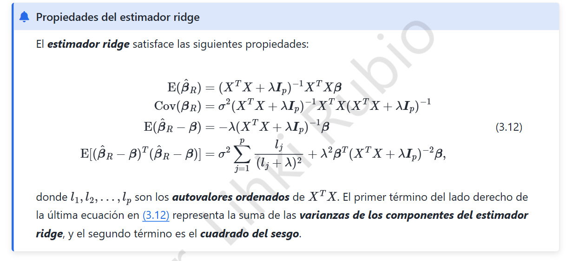

# 3. Ridge · Propiedades del estimador (3.12)

## 3.1 Modelo y condiciones

Partimos del modelo lineal $y=X\beta+\varepsilon$, con diseño $X\in\mathbb R^{n\times p}$ fijo, $\mathbb E(\varepsilon)=0$, $\operatorname{Cov}(\varepsilon)=\sigma^2I_n$ y penalización $\lambda>0$. Suponemos las variables centradas para no penalizar el intercepto.

El estimador ridge y la matriz auxiliar son

$$\hat\beta_R=(X^TX+\lambda I_p)^{-1}X^Ty,\qquad A=(X^TX+\lambda I_p)^{-1}.$$

La inversa existe porque $X^TX$ es semidefinida positiva y la suma con $\lambda I_p$ es definida positiva. Además, $A$ es simétrica.

## 3.2 Primera propiedad: esperanza

Reemplazamos $y$ por $X\beta+\varepsilon$ y tomamos esperanza:

$$\begin{aligned}\mathbb E(\hat\beta_R)&=\mathbb E[AX^T(X\beta+\varepsilon)]\\&=AX^TX\beta+AX^T\underbrace{\mathbb E(\varepsilon)}_{0}.\end{aligned}$$

$$\boxed{\mathbb E(\hat\beta_R)=(X^TX+\lambda I_p)^{-1}X^TX\beta.}$$

## 3.3 Segunda propiedad: covarianza

La parte aleatoria es $AX^T\varepsilon$. Usamos $\operatorname{Cov}(BU)=B\operatorname{Cov}(U)B^T$:

$$\begin{aligned}\operatorname{Cov}(\hat\beta_R)&=AX^T(\sigma^2I_n)XA^T\\&=\sigma^2AX^TXA.\end{aligned}$$

$$\boxed{\operatorname{Cov}(\hat\beta_R)=\sigma^2(X^TX+\lambda I)^{-1}X^TX(X^TX+\lambda I)^{-1}.}$$

## 3.4 Tercera propiedad: sesgo

De $A(X^TX+\lambda I)=I$ se deduce $AX^TX=I-\lambda A$. Por lo tanto,

$$\begin{aligned}\mathbb E(\hat\beta_R-\beta)&=(AX^TX-I)\beta\\&= -\lambda A\beta.\end{aligned}$$

$$\boxed{\operatorname{Sesgo}(\hat\beta_R)=-\lambda(X^TX+\lambda I_p)^{-1}\beta.}$$

El parámetro $\lambda$ introduce deliberadamente sesgo para disminuir la variabilidad del estimador.

## 3.5 Cuarta propiedad: error cuadrático medio

Para un vector estimador $\hat\beta$ se cumple la descomposición

$$\mathbb E\|\hat\beta-\beta\|_2^2=\operatorname{tr}[\operatorname{Cov}(\hat\beta)]+\|\operatorname{Sesgo}(\hat\beta)\|_2^2.$$

Si $l_1,\dots,l_p$ son los autovalores no negativos de $X^TX$, al diagonalizar ortogonalmente esa matriz se obtiene

$$\operatorname{tr}(AX^TXA)=\sum_{j=1}^p\frac{l_j}{(l_j+\lambda)^2}.$$

Como $A$ es simétrica, el cuadrado del sesgo es $\lambda^2\beta^TA^2\beta$. En consecuencia,

$$\boxed{\mathbb E\|\hat\beta_R-\beta\|_2^2=\sigma^2\sum_{j=1}^p\frac{l_j}{(l_j+\lambda)^2}+\lambda^2\beta^T(X^TX+\lambda I_p)^{-2}\beta.}$$

**Interpretación:** el primer sumando mide varianza y el segundo sesgo al cuadrado. Aumentar $\lambda$ reduce la varianza pero puede aumentar el sesgo: es el compromiso **sesgo–varianza**. Al contrario de mínimos cuadrados sin regularizar, ridge sigue estando definido incluso si $X^TX$ es singular, siempre que $\lambda>0$.

> **Precisión de notación:** el estimador es $\hat\beta_R$; el vector poblacional $\beta$ es un parámetro fijo, no una variable aleatoria en el modelo clásico.
