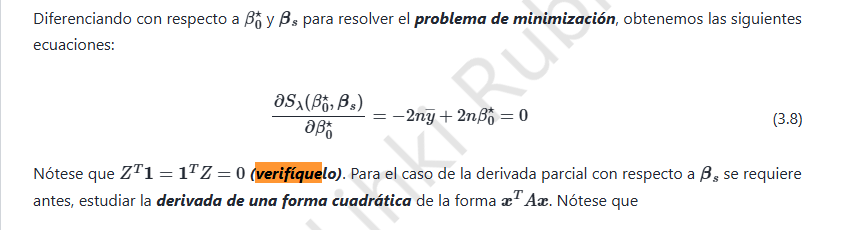

# 4. Ridge · Centrado, intercepto y formas cuadráticas

## 4.1 Identidad del diseño centrado

Sea $Z$ la matriz con columnas $z_{ij}=(x_{ij}-\bar x_j)/s_j$, donde $s_j>0$ y $\bar x_j=(1/n)\sum_i x_{ij}$. Sea $\mathbf 1$ el vector de $n$ unos.

La componente $j$ del producto $Z^T\mathbf 1$ es

$$\begin{aligned}(Z^T\mathbf1)_j&=\sum_{i=1}^nz_{ij}\\&=\frac{1}{s_j}\left(\sum_{i=1}^nx_{ij}-n\bar x_j\right)=0.\end{aligned}$$

De manera inmediata, por transposición,

$$\boxed{Z^T\mathbf 1=\mathbf0\quad\text{y}\quad\mathbf1^TZ=\mathbf0^T.}$$

El resultado se debe al *centrado*; la división por $s_j$ no altera que la suma sea cero.

## 4.2 Derivada respecto al intercepto (ecuación 3.8)

El criterio ridge sin penalización del intercepto es

$$S_\lambda(\beta_0,\beta)=(y-\beta_0\mathbf1-Z\beta)^T(y-\beta_0\mathbf1-Z\beta)+\lambda\beta^T\beta.$$

Denotamos por $r=y-\beta_0\mathbf1-Z\beta$ los residuos. Entonces,

$$\frac{\partial S_\lambda}{\partial\beta_0}=-2\mathbf1^Tr=-2n\bar y+2n\beta_0+2\underbrace{\mathbf1^TZ}_{0}\beta.$$

Igualando a cero se obtiene $\boxed{\hat\beta_0=\bar y}$. Si también se centra la respuesta, $\bar y=0$.

## 4.3 Derivada de la forma cuadrática

Sean $u=(u_1,\ldots,u_p)^T$ y una matriz $M=(m_{jk})$. Como $u^TMu=\sum_{j,k}m_{jk}u_ju_k$, la derivada de cada componente es

$$\frac{\partial(u^TMu)}{\partial u_r}=\sum_km_{rk}u_k+\sum_jm_{jr}u_j.$$

Agrupando,

$$\boxed{\nabla_u(u^TMu)=(M+M^T)u.}$$

En particular, si $M=M^T$, queda $\nabla_u(u^TMu)=2Mu$; además, $\nabla_u(a^Tu)=a$.

## 4.4 Ecuación normal ridge y verificación del mínimo

Derivando con respecto a $\beta$:

$$\nabla_\beta S_\lambda=-2Z^Ty+2\beta_0Z^T\mathbf1+2Z^TZ\beta+2\lambda\beta.$$

Usamos $Z^T\mathbf1=0$ e igualamos a cero:

$$\boxed{(Z^TZ+\lambda I_p)\hat\beta=Z^Ty\quad\Longrightarrow\quad\hat\beta=(Z^TZ+\lambda I_p)^{-1}Z^Ty.}$$

La hessiana es $2(Z^TZ+\lambda I_p)$, definida positiva cuando $\lambda>0$. Por consiguiente, el punto crítico es un mínimo global único.

**Conclusión:** centrar las características desacopla el intercepto de los coeficientes. Ridge penaliza los coeficientes, no el nivel medio de la respuesta.
