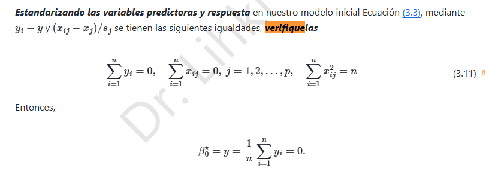

# 5. Ridge · Verificación de la estandarización (3.11)

## 5.1 Convención de normalización

El enunciado define, para cada columna $j$, la media $\bar x_j=\frac1n\sum_{i=1}^nx_{ij}$ y la escala **poblacional**

$$s_j^2=\frac1n\sum_{i=1}^n(x_{ij}-\bar x_j)^2,\qquad s_j>0.$$

Tras la transformación $\tilde x_{ij}=(x_{ij}-\bar x_j)/s_j$ y $\tilde y_i=y_i-\bar y$, queremos demostrar las identidades indicadas en las notas.

## 5.2 Primera identidad: suma de la respuesta centrada

$$\begin{aligned}\sum_{i=1}^n\tilde y_i&=\sum_{i=1}^n(y_i-\bar y)\\&=\sum_{i=1}^ny_i-n\bar y\\&=n\bar y-n\bar y=\boxed{0}.\end{aligned}$$

## 5.3 Segunda identidad: suma de cada predictor estandarizado

$$\begin{aligned}\sum_{i=1}^n\tilde x_{ij}&=\frac1{s_j}\sum_{i=1}^n(x_{ij}-\bar x_j)\\&=\frac{n\bar x_j-n\bar x_j}{s_j}=\boxed{0}.\end{aligned}$$

Este resultado implica que cada columna de la matriz estandarizada tiene media cero.

## 5.4 Tercera identidad: norma cuadrática

Como $\sum_i(x_{ij}-\bar x_j)^2=ns_j^2$ por definición,

$$\boxed{\sum_{i=1}^n\tilde x_{ij}^{\,2}=\frac{1}{s_j^2}\sum_{i=1}^n(x_{ij}-\bar x_j)^2=\frac{ns_j^2}{s_j^2}=n.}$$

La diagonal de la matriz de productos cruzados es $Z^TZ=[\sum_i\tilde x_{ij}\tilde x_{ik}]_{jk}$, y por lo anterior $(Z^TZ)_{jj}=n$.

## 5.5 Implicación para el intercepto

Ya vimos que $\hat\beta_0=\bar{\tilde y}$. Por la primera identidad, $\bar{\tilde y}=0$; en consecuencia,

$$\boxed{\hat\beta_0=0\quad\text{en el problema centrado}.}$$

> **Atención a la convención:** si se utiliza la desviación típica muestral $s_j^2=\frac{1}{n-1}\sum_i(x_{ij}-\bar x_j)^2$, la tercera identidad resulta $n-1$, no $n$. La igualdad del profesor exige el denominador $n$. Si alguna columna es constante, $s_j=0$ y debe excluirse o tratarse aparte.
