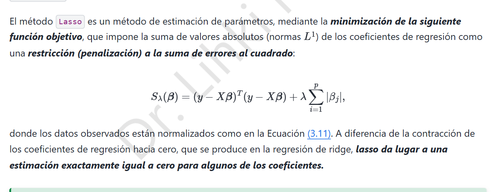

# 6. Regresión Lasso · Estimación y algoritmo LARS

## 6.1 Problema de optimización

El método Lasso utiliza la penalización $\ell_1$ sobre los coeficientes:

$$\boxed{\hat\beta_L\in\arg\min_{\beta\in\mathbb R^p}\Big\{S_\lambda(\beta)=\|y-X\beta\|_2^2+\lambda\sum_{j=1}^p|\beta_j|\Big\}.}$$

La diferencia principal con Ridge es que $|\beta_j|$ **no es diferenciable en cero**. Por tanto, hay que trabajar con **subgradientes**; no es válido derivar el valor absoluto como una función suave en todos los puntos.

## 6.2 Condiciones de optimalidad

El subgradiente de $|t|$ es $\partial|t|=\{1\}$ si $t>0$, $\{-1\}$ si $t<0$ y $[-1,1]$ si $t=0$. Como $S_\lambda$ es convexa, $\hat\beta_L$ minimiza globalmente cuando

$$0\in -2X^T(y-X\hat\beta_L)+\lambda\partial\|\hat\beta_L\|_1.$$

Componente por componente,

$$\boxed{\begin{cases}x_j^T(y-X\hat\beta_L)=\frac\lambda2\operatorname{sign}(\hat\beta_j),&\hat\beta_j\ne0,\\|x_j^T(y-X\hat\beta_L)|\le\frac\lambda2,&\hat\beta_j=0.\end{cases}}$$

La segunda condición explica por qué algunas variables pueden tener exactamente coeficiente cero: cuando su correlación absoluta con los residuos no supera el umbral $\lambda/2$, se mantiene inactiva.

## 6.3 Solución explícita bajo ortogonalidad

Supongamos que los datos están centrados y $X^TX=nI_p$. Para mínimos cuadrados ordinarios, $\hat\beta_j^{MCO}=x_j^Ty/n$. Al desarrollar el cuadrado, ignorando constantes independientes de $\beta$, el problema se separa en términos

$$g_j(b)=n(b-\hat\beta_j^{MCO})^2+\lambda|b|.$$

**Si $b>0$**, la derivada se anula en $b=\hat\beta_j^{MCO}-\lambda/(2n)$, siempre que el resultado sea positivo. **Si $b<0$**, se anula en $b=\hat\beta_j^{MCO}+\lambda/(2n)$ si es negativo. **Si $|\hat\beta_j^{MCO}|\le\lambda/(2n)$**, las condiciones de subgradiente se satisfacen con $b=0$.

De los tres casos resulta la **función de umbral suave**:

$$\boxed{\hat\beta_j^L=\operatorname{sign}(\hat\beta_j^{MCO})\max\left(\left|\hat\beta_j^{MCO}\right|-\frac{\lambda}{2n},\ 0\right).}$$

Con Ridge en el mismo caso ortogonal, $\hat\beta_j^R=\frac{n}{n+\lambda}\hat\beta_j^{MCO}$. Lasso desplaza y puede anular coeficientes; Ridge los contrae proporcionalmente sin anularlos por completo en general.

## 6.4 Caso general: descenso por coordenadas

Sin ortogonalidad no suele existir una fórmula cerrada simultánea para todos los $\beta_j$. Se optimiza una coordenada a la vez. Definimos el residuo parcial $r^{(j)}=y-\sum_{k\ne j}x_k\beta_k$. Si $\|x_j\|^2=n$, se actualiza:

$$\boxed{\beta_j\leftarrow\frac1n\operatorname{sign}(x_j^Tr^{(j)})\max\big(|x_j^Tr^{(j)}|-\tfrac\lambda2,0\big).}$$

Se repite para $j=1,\ldots,p$ hasta cumplir una tolerancia de convergencia. La convexidad justifica que el óptimo alcanzado satisfaga las condiciones globales.

## 6.5 Algoritmo LARS y trayectoria de Lasso

LARS (*Least Angle Regression*) construye una trayectoria de coeficientes al variar la penalización. En la versión Lasso, el procedimiento es:

1. Partir de todos los coeficientes iguales a cero, con penalización grande.
2. Identificar el predictor con mayor correlación absoluta con el residuo e incorporarlo al conjunto activo.
3. Desplazar los coeficientes activos en una dirección equiangular hasta que entra otra variable o uno de los coeficientes activos llega a cero.
4. Cuando un coeficiente cruza cero, la modificación de LARS para Lasso lo retira del conjunto activo.
5. Continuar hasta obtener la penalización deseada.

La trayectoria es lineal a tramos mientras se mantengan el conjunto activo y los signos, ya que entonces

$$\hat\beta_{\mathcal A}(\lambda)=(X_{\mathcal A}^TX_{\mathcal A})^{-1}\big(X_{\mathcal A}^Ty-\tfrac\lambda2s_{\mathcal A}\big),$$

**si** la submatriz correspondiente es invertible. En situaciones de colinealidad exacta pueden existir soluciones no únicas y se requieren decisiones adicionales del algoritmo.

**Conclusión:** Ridge reduce varianza; Lasso también puede seleccionar variables. La norma $\ell_1$ produce la posibilidad de coeficientes exactamente nulos.
