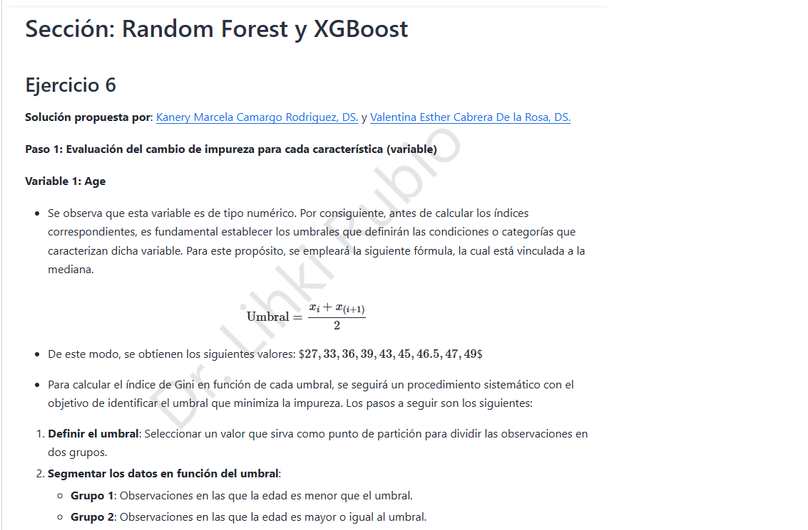
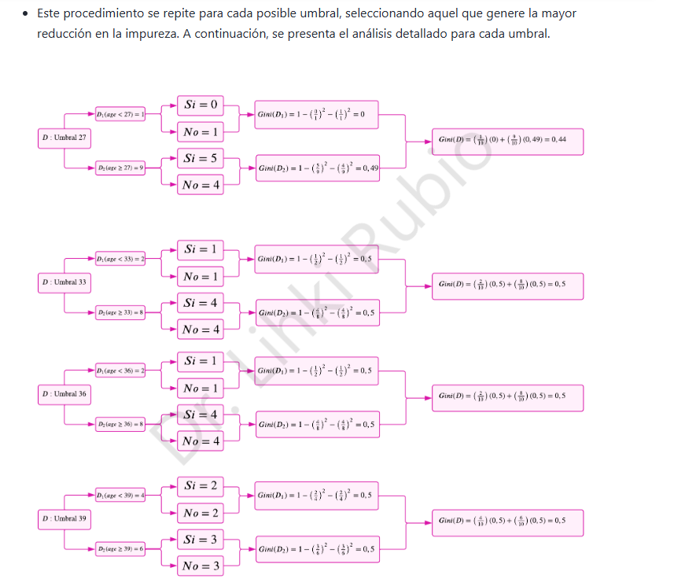
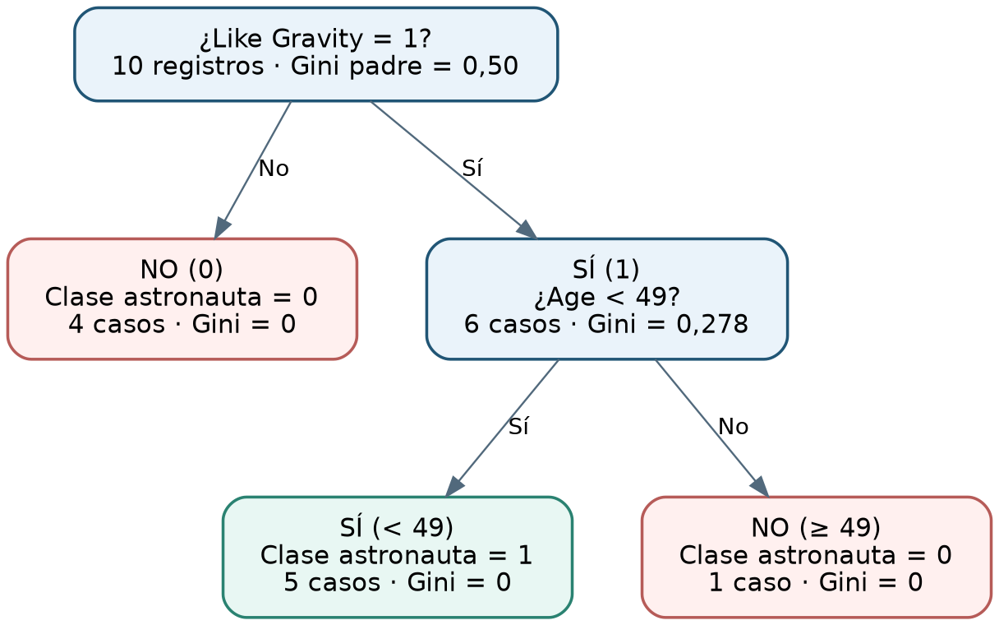

# 7. Árbol de decisión · Revisión del ejercicio 6

## 7.1 ¿Qué debía identificarse?

El documento solicita buscar un error en la solución del [ejercicio 6, Random Forest y XGBoost](https://lihkir.github.io/MachineLearning/exercises_sols.html). La solución externa propone un árbol para la etiqueta *Gonna Be an Astronaut* según edad, gusto por perros y gusto por la gravedad. Contrastaremos los tamaños de nodos, los índices de Gini y el árbol resultante.

Para dos clases, la impureza de un nodo es $G(D)=1-p_0^2-p_1^2$. Tras una partición en $D_1,D_2$, la impureza ponderada es

$$\boxed{G_{split}=\frac{|D_1|}{|D|}G(D_1)+\frac{|D_2|}{|D|}G(D_2).}$$

La partición preferida es la de menor impureza ponderada, pues maximiza la reducción frente al nodo padre.

## 7.2 Primer error: tabla del umbral 36 de edad

La muestra original tiene 10 observaciones, con 5 de cada clase. Los umbrales ordenados pasan una observación adicional a la rama izquierda al avanzar al siguiente valor distinto. La solución publicada registra **2 observaciones** a la izquierda del umbral 36, igual que en el umbral 33, pese a que se incorporó otra edad.

Con 3 registros a la izquierda y 7 a la derecha, y proporciones de clases $(2,1)$ y $(3,4)$ (o intercambiadas), tenemos

$$G(D_1)=1-(2/3)^2-(1/3)^2=4/9,\qquad G(D_2)=1-(3/7)^2-(4/7)^2=24/49.$$

La impureza ponderada correcta es

$$\boxed{G_{36}=\tfrac{3}{10}\cdot\tfrac49+\tfrac{7}{10}\cdot\tfrac{24}{49}=\tfrac{10}{21}\approx0.47619\quad\text{y no }0.500.}$$

En la ilustración del umbral 39 aparece además una ponderación escrita como $6/10+6/10$; con grupos de tamaños 4 y 6 debe usarse $4/10$ y $6/10$.

## 7.3 Error decisivo: segundo nivel del árbol

La solución selecciona inicialmente **Like Gravity**, que produce cuatro casos negativos puros y una rama positiva con seis ejemplos. Para la rama `Like Gravity = Sí`, el material publicado entrega exactamente:

| Edad | Like Dogs | Astronauta |
|--:|:--:|:--:|
| 30 | 1 | 1 |
| 36 | 0 | 1 |
| 44 | 1 | 1 |
| 47 | 1 | 1 |
| 47 | 0 | 1 |
| 51 | 1 | 0 |

Cinco casos tienen clase **Sí** y únicamente el caso de edad **51** tiene clase **No**. Por eso, el nodo padre de esta rama tiene

$$G(D)=1-(5/6)^2-(1/6)^2=10/36\approx0.27778.$$

La edad crea umbrales candidatos **33, 40, 45.5 y 49**; el último separa el registro de 51 de los demás.

| Umbral de edad | Tamaños | Composición de clases | Gini ponderado |
|:--|:--|:--|--:|
| 33 | 1 y 5 | izq. (1 Sí, 0 No); der. (4 Sí, 1 No) | 0.2667 |
| 40 | 2 y 4 | izq. (2 Sí, 0 No); der. (3 Sí, 1 No) | 0.2500 |
| 45.5 | 3 y 3 | izq. (3 Sí, 0 No); der. (2 Sí, 1 No) | 0.2222 |
| **49** | **5 y 1** | **izq. (5 Sí, 0 No); der. (0 Sí, 1 No)** | **0.0000** |

En particular,

$$\boxed{G_{49}=\frac56\left[1-(5/5)^2\right]+\frac16\left[1-(1/1)^2\right]=0.}$$

**Conclusión verificable:** el umbral **49** es superior al **45.5** señalado como mejor en la solución publicada: el corte a 49 hace que las dos hojas sean puras, por lo que no hay razón para introducir una partición adicional por `Like Dogs`.

## 7.4 Revisión de Like Dogs

En los mismos seis registros, `Like Dogs = 1` corresponde a cuatro observaciones: **3 Sí y 1 No**; `Like Dogs = 0` contiene **2 Sí y 0 No**. Luego

$$G_{Dogs}=\frac46\left[1-(3/4)^2-(1/4)^2\right]+\frac26\cdot0=\frac46\cdot\frac38=\boxed{0.25}.$$

Por tanto, el índice no es 0.17 en esta rama, como se afirma en la solución publicada. Frente a $G_{Age<49}=0$, la edad es la mejor partición.

## 7.5 Árbol final corregido

Interpretación de las reglas del árbol:

- Si `Like Gravity = No`, se predice `Astronauta = No` (4 de 4 casos).
- Si `Like Gravity = Sí` y `Age < 49`, se predice `Astronauta = Sí` (5 de 5 casos).
- Si `Like Gravity = Sí` y `Age >= 49`, se predice `Astronauta = No` (1 de 1 caso).

Los diez registros del ejercicio quedan separados sin impureza en las hojas. Esto **no demuestra que el árbol generalice sin errores** fuera de la muestra: solo describe las diez observaciones utilizadas.

> **Hallazgo adicional:** el umbral $(x_i+x_{i+1})/2$ es el punto medio de dos edades ordenadas consecutivas, no la mediana estadística de todas las edades.
