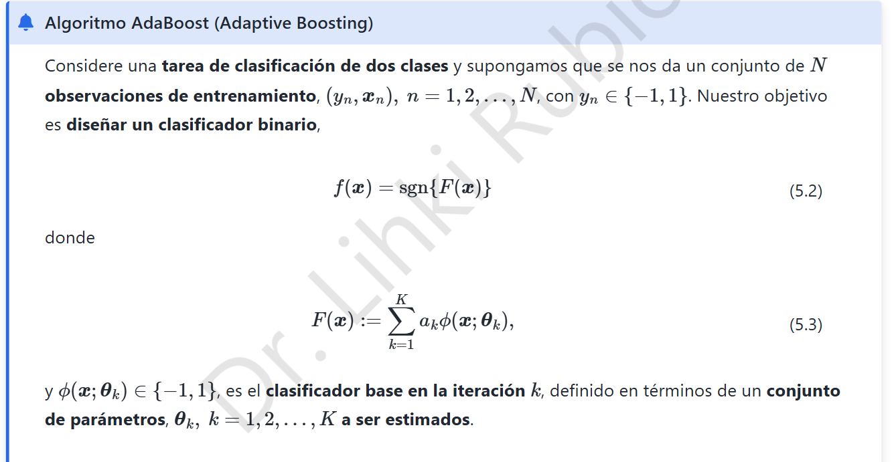
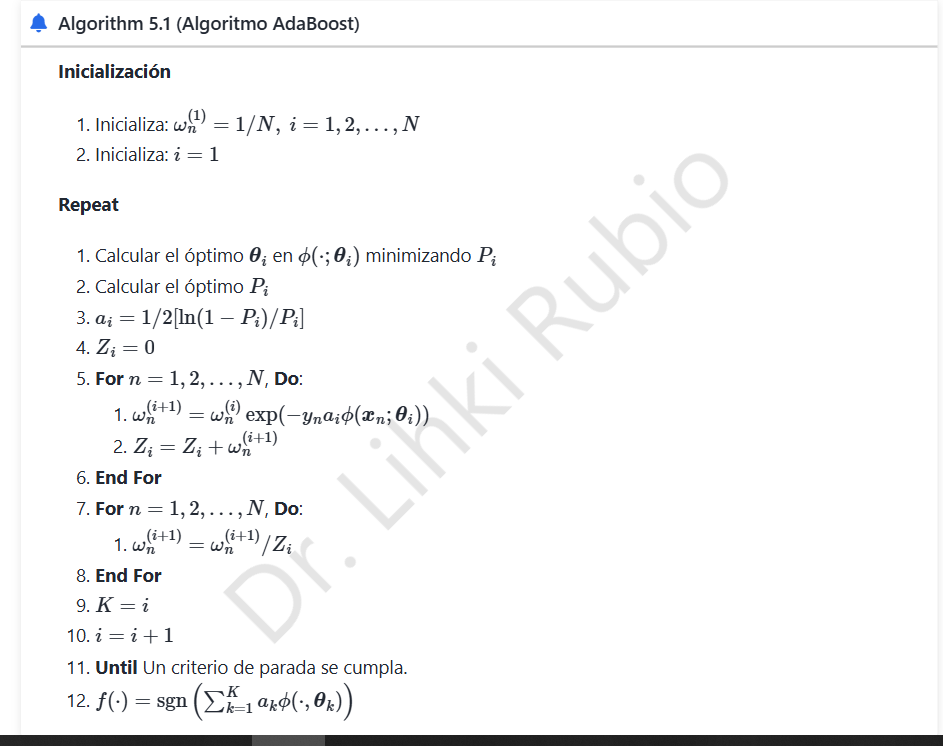

# 8. AdaBoost · Derivación del algoritmo

## 8.1 Objetivo y esquema aditivo

En clasificación binaria, $y_n\in\{-1,1\}$, cada clasificador débil $\phi(x;\theta_i)\in\{-1,1\}$ y el conjunto produce

$$F_K(x)=\sum_{i=1}^K\alpha_i\phi(x;\theta_i),\qquad f_K(x)=\operatorname{sign}(F_K(x)).$$

AdaBoost selecciona sucesivamente clasificadores para reducir la **pérdida exponencial**:

$$J(F)=\sum_{n=1}^N\exp[-y_nF(x_n)].$$

En la iteración $i$ se conserva la combinación anterior $F_{i-1}$ y se agrega $\alpha\phi$.

## 8.2 ¿De dónde salen los pesos de las observaciones?

El criterio del nuevo clasificador se escribe

$$\begin{aligned}J(F_{i-1}+\alpha\phi)&=\sum_{n=1}^Ne^{-y_nF_{i-1}(x_n)}e^{-\alpha y_n\phi(x_n)}.\end{aligned}$$

Definimos pesos normalizados $w_n^{(i)}=e^{-y_nF_{i-1}(x_n)}/\sum_re^{-y_rF_{i-1}(x_r)}$. Con $F_0=0$, todos los ejemplos comienzan con el mismo peso: $w_n^{(1)}=1/N$.

## 8.3 El clasificador débil minimiza el error ponderado

La cantidad $y_n\phi(x_n)$ vale $+1$ si hay acierto y $-1$ si hay error. Para el error ponderado

$$P_i=\sum_{n:y_n\ne\phi_i(x_n)}w_n^{(i)},$$

la pérdida de la etapa, salvo un factor positivo que no cambia el mínimo, es

$$J_i(\alpha)=(1-P_i)e^{-\alpha}+P_ie^{\alpha}.$$

Cuando $\alpha>0$, minimizar respecto a $\phi_i$ equivale a minimizar $P_i$. Así se justifica entrenar el clasificador que comete menos errores *ponderados*, no simplemente menos errores sin pesos.

## 8.4 Cálculo del peso del clasificador

Derivamos:

$$\frac{dJ_i}{d\alpha}=-(1-P_i)e^{-\alpha}+P_ie^{\alpha}.$$

Al igualar a cero y despejar,

$$P_ie^{\alpha}=(1-P_i)e^{-\alpha}\Longrightarrow e^{2\alpha}=\frac{1-P_i}{P_i}.$$

Por tanto,

$$\boxed{\alpha_i=\frac12\ln\left(\frac{1-P_i}{P_i}\right).}$$

La segunda derivada $J_i''=(1-P_i)e^{-\alpha}+P_ie^{\alpha}>0$ demuestra que es mínimo. Bajo el supuesto habitual $0<P_i<1/2$, se cumple $\alpha_i>0$. Si $P_i=1/2$, el clasificador no aporta poder discriminante; si $P_i=0$, la fórmula requiere tratamiento como clasificador perfecto (detención o límite).

**Corrección:** es fundamental que el logaritmo abarque la **fracción completa**, no solo el numerador.

## 8.5 Actualización y normalización de pesos

Después de elegir $\phi_i$ y $\alpha_i$, el peso de la observación $n$ es

$$\boxed{w_n^{(i+1)}=\frac{w_n^{(i)}\exp[-\alpha_i y_n\phi_i(x_n)]}{Z_i},\quad Z_i=\sum_{r=1}^Nw_r^{(i)}e^{-\alpha_i y_r\phi_i(x_r)}.}$$

Como los ejemplos mal clasificados tienen $y_n\phi_i=-1$, su peso se multiplica por $e^{\alpha_i}$; los aciertos lo hacen por $e^{-\alpha_i}$. De ese modo la siguiente etapa presta más atención a los casos difíciles.

El normalizador depende de $P_i$:

$$\boxed{Z_i=(1-P_i)e^{-\alpha_i}+P_ie^{\alpha_i}=2\sqrt{P_i(1-P_i)}.}$$

Con los nuevos pesos, el conjunto de ejemplos antes mal clasificados recibe masa total

$$\frac{P_ie^{\alpha_i}}{Z_i}=\frac12.$$

## 8.6 Cota de entrenamiento

Si $y_nF_K(x_n)\le0$, entonces $\mathbf1\{\operatorname{sign}F_K(x_n)\ne y_n\}\le e^{-y_nF_K(x_n)}$ (la convención en empate debe tratarse de manera coherente). En la pérdida exponencial promedio,

$$\boxed{L_S(f_K)\le\frac1N\sum_{n=1}^Ne^{-y_nF_K(x_n)}=\prod_{i=1}^KZ_i=\prod_{i=1}^K2\sqrt{P_i(1-P_i)}.}$$

Si cada clasificador mantiene $P_i\le\tfrac12-\gamma$ con $\gamma>0$, el producto es a lo sumo $(\sqrt{1-4\gamma^2})^K$, por lo que disminuye exponencialmente con las iteraciones.

**Conclusión:** AdaBoost transforma clasificadores débiles en una combinación ponderada. Reorienta iterativamente la distribución hacia observaciones con error y produce una regla final basada en el signo de la suma ponderada.
